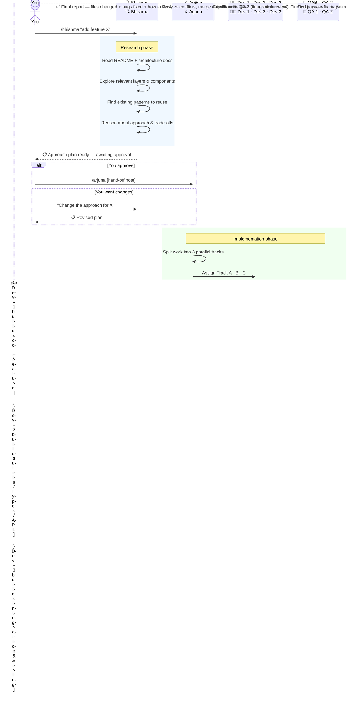
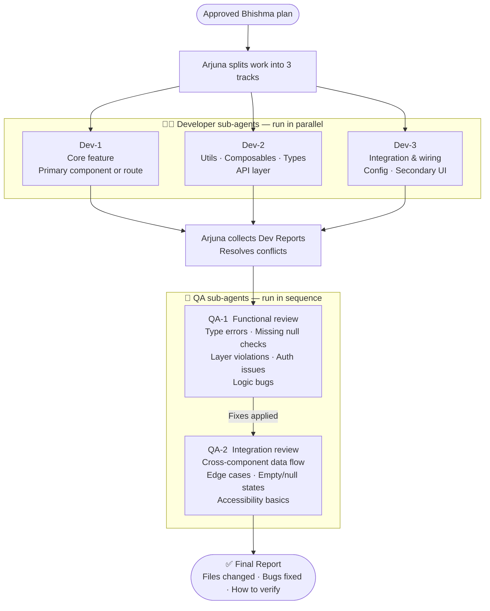

<div align="center">

# ⚔️ Bhishma & Arjuna

### A two-agent Claude Code pipeline — plan first, build second, ship clean.

[](https://opensource.org/licenses/MIT)
[](https://claude.ai/claude-code)
[](https://github.com/HarshavardhanIn/bhishma-arjuna/pulls)

</div>

---

## The problem

Most AI coding sessions jump straight into writing code. The agent makes assumptions, picks the wrong pattern, ignores a constraint from the architecture guide — and you get working code that breaks something else.

Bhishma & Arjuna separates thinking from building. You see the plan before a single line is written.

---

## How the pipeline works



---

## Inside Arjuna — parallel dev, sequential QA



---

## The two skills

| | Bhishma | Arjuna |
|---|---|---|
| **Role** | Research & Planning | Orchestration & Implementation |
| **Input** | Your requirement | Approved Bhishma hand-off note |
| **Output** | Structured approach plan | Final report with all changes |
| **Agents** | 1 (Bhishma) | 5 (Dev-1, Dev-2, Dev-3, QA-1, QA-2) |
| **Human gate** | ✅ Waits for approval | ❌ Runs to completion |
| **Code written** | None | All of it |

---

## Installation

### Into a specific project

```bash
git clone https://github.com/HarshavardhanIn/bhishma-arjuna.git
cp -r bhishma-arjuna/.claude/skills/bhishma your-project/.claude/skills/
cp -r bhishma-arjuna/.claude/skills/arjuna  your-project/.claude/skills/
```

Restart Claude Code, then run `/skills` — you should see both listed.

### Globally (all projects)

```bash
git clone https://github.com/HarshavardhanIn/bhishma-arjuna.git
mkdir -p ~/.claude/skills
cp -r bhishma-arjuna/.claude/skills/bhishma ~/.claude/skills/
cp -r bhishma-arjuna/.claude/skills/arjuna  ~/.claude/skills/
```

### One-liner

```bash
bash <(curl -s https://raw.githubusercontent.com/HarshavardhanIn/bhishma-arjuna/main/install.sh)
```

---

## Usage

**Step 1 — Give Bhishma your requirement**

```
/bhishma Add a data export button to the Connect portal that generates a CSV
```

Bhishma reads your codebase and returns a structured plan: approach, files to change, architecture constraints, risks, and complexity estimate.

**Step 2 — Approve or revise**

```
Approved — hand off to Arjuna
```

Or ask for changes and Bhishma revises the plan and waits again.

**Step 3 — Hand off to Arjuna**

```
/arjuna [paste the Hand-off note from the Bhishma plan]
```

**Step 4 — Review the final report**

Arjuna delivers a report with every file changed, every bug QA found and fixed, and step-by-step verification instructions.

---

## Repo structure

```
.claude/
└── skills/
    ├── bhishma/
    │   └── SKILL.md    ← Research, plan, human approval gate
    └── arjuna/
        └── SKILL.md    ← 3 dev agents (parallel) + 2 QA agents (sequential)
README.md
install.sh
```

---

## Works with any codebase

Built for a Nuxt 4 project with a layered architecture, but not framework-specific. Bhishma reads whatever README, architecture guide, and CLAUDE.md it finds and adapts accordingly. Works with React, Next.js, Laravel, Django — any codebase with readable docs.

---

## Contributing

PRs welcome — better QA prompts, smarter dev track splitting, tighter constraint checking.

---

<div align="center">
Made with Claude Code · MIT Licence
</div>
