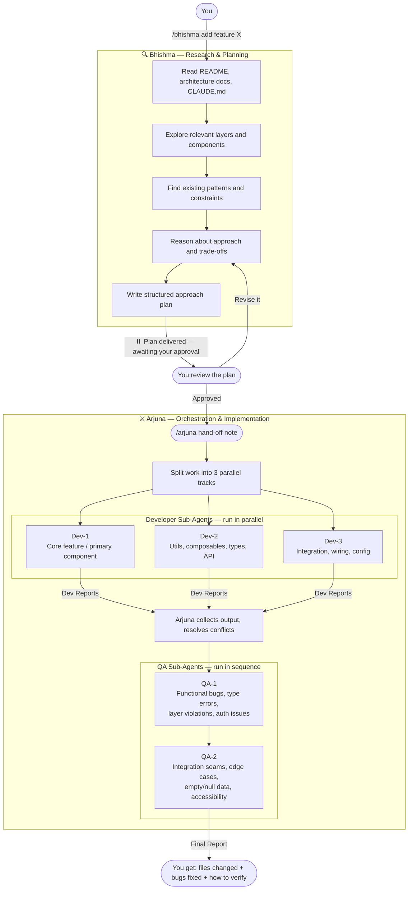

# Bhishma & Arjuna — Claude Code Skills

A two-agent pipeline for structured software development in Claude Code.

**Bhishma** does the thinking. **Arjuna** does the building. **You** stay in control of the handoff.

---

## How it works



---

## The two skills

### `/bhishma` — Research & Planning

You give Bhishma a requirement. It:

1. Reads the project's README, architecture guide, and CLAUDE.md
2. Explores the relevant layers and components in the codebase
3. Finds existing patterns to reuse or respect
4. Reasons about the simplest correct approach and its trade-offs
5. Produces a structured plan covering: approach, files to change, architecture constraints, risks, and complexity estimate
6. **Pauses and waits for your approval**

Nothing gets written until you approve. If you want changes, Bhishma revises the plan and waits again.

### `/arjuna` — Orchestration & Implementation

You give Arjuna the hand-off note from the approved Bhishma plan. It:

1. Splits the work into **three parallel developer tracks** (core feature / supporting layer / integration)
2. Spawns **Dev-1, Dev-2, Dev-3** as sub-agents — they work independently and communicate through Arjuna when there are shared types or interfaces
3. Collects all three Dev Reports and resolves any conflicts
4. Hands the combined output to **QA-1** (functional bugs, type errors, layer violations)
5. QA-1 fixes what it finds, then **QA-2** takes over (integration seams, edge cases, accessibility)
6. QA-2 fixes what it finds
7. Arjuna compiles the **Final Report** — every file changed, every bug found and fixed, and step-by-step verification instructions

---

## Why this structure

**Bhishma first** means the plan is reviewed before anything is built. Wrong approaches get caught at the plan stage, not after hours of implementation.

**Three developers in parallel** means large features get done faster. Arjuna's job is to keep them from stepping on each other — it assigns ownership of files explicitly so no two agents write to the same file without coordination.

**Two QA passes** means two different angles of attack. QA-1 focuses on correctness inside each file. QA-2 focuses on correctness across the system.

**You approve once, get a report at the end.** You are not involved in the middle of the build — Arjuna manages that. But you see everything that happened.

---

## Installation

### Option 1 — Into a specific project

```bash
git clone https://github.com/harshavardhan03/bhishma-arjuna.git
cp -r bhishma-arjuna/.claude/skills/bhishma your-project/.claude/skills/
cp -r bhishma-arjuna/.claude/skills/arjuna  your-project/.claude/skills/
```

Restart Claude Code in your project, then run `/skills` to confirm both appear.

### Option 2 — Globally (available in all projects)

```bash
git clone https://github.com/harshavardhan03/bhishma-arjuna.git
mkdir -p ~/.claude/skills
cp -r bhishma-arjuna/.claude/skills/bhishma ~/.claude/skills/
cp -r bhishma-arjuna/.claude/skills/arjuna  ~/.claude/skills/
```

### Option 3 — One-liner

```bash
bash <(curl -s https://raw.githubusercontent.com/harshavardhan03/bhishma-arjuna/main/install.sh)
```

It will ask whether you want project-level or global installation.

---

## Usage

### Step 1 — Describe your requirement to Bhishma

```
/bhishma Add a data export button to the Connect portal dashboard that generates a CSV
```

Bhishma explores your codebase and returns something like:

```
## Bhishma Approach Plan

### Requirement summary
Add a CSV export button to the Connect dashboard. On click, it fetches the current
table data from the BFF, formats it as CSV in the browser, and triggers a download.

### Files to create or modify
- layers/connect/components/Dashboard/ExportButton.vue   [create]
- layers/connect/composables/useExport.ts               [create]
- server/api/connect/export.get.ts                      [create]
- layers/connect/pages/dashboard.vue                    [modify — add button]

### Estimated complexity
Medium — three new files, one modified. SSR is not needed for the export endpoint.
Auth token must be passed; handled via the existing useConnectAuth composable.

### Hand-off note for Arjuna
Build a CSV export feature for the Connect dashboard. Dev-1 builds ExportButton.vue
and the dashboard integration. Dev-2 builds useExport.ts and the fetch logic.
Dev-3 builds the BFF endpoint server/api/connect/export.get.ts with auth validation.
...

⏸️ Bhishma has completed the research and planning phase.
- To proceed: reply with "Approved — hand off to Arjuna"
- To revise: reply with your feedback
```

### Step 2 — Approve or ask for changes

```
Approved — hand off to Arjuna
```

Or:

```
Change the BFF endpoint — it should stream the CSV rather than return it all at once
```

Bhishma revises the plan and waits again.

### Step 3 — Hand off to Arjuna

Copy the "Hand-off note for Arjuna" from the plan:

```
/arjuna Build a CSV export feature for the Connect dashboard. Dev-1 builds ExportButton.vue ...
```

Arjuna coordinates Dev-1, Dev-2, Dev-3 in parallel, then QA-1 and QA-2 sequentially, and delivers the final report.

### Step 4 — Review the final report

The report lists every file created or modified, every bug QA found and fixed, and step-by-step instructions for verifying the feature works.

---

## Repo structure

```
.claude/
└── skills/
    ├── bhishma/
    │   └── SKILL.md    ← Bhishma: research, plan, await approval
    └── arjuna/
        └── SKILL.md    ← Arjuna: 3 devs (parallel) + 2 QA (sequential) + final report
README.md
install.sh
```

---

## Works with any codebase

The skills were built for a Nuxt 4 project with a layered architecture, but they are not framework-specific. Bhishma reads whatever README, architecture guide, and CLAUDE.md it finds in your repo and adapts its analysis accordingly.

---

## Contributing

Open a PR. Better QA prompts, smarter dev track splitting, improved architecture constraint checking — all welcome.

---

## Licence

MIT
