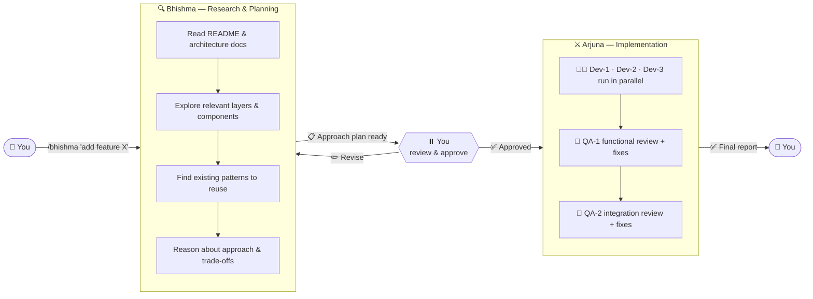
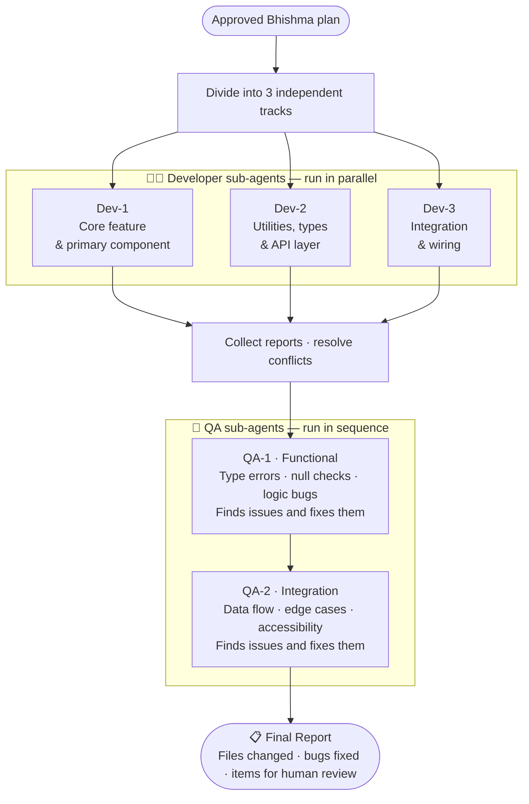

# Bhishma & Arjuna — Claude Code Skills

<div align="center">


**A two-skill pipeline for structured software development using Claude Code.**<br>
Bhishma researches and plans. Arjuna builds and tests. You approve everything in between.

</div>

---

## The problem

Most AI coding sessions jump straight into writing code. The agent makes assumptions, picks the wrong pattern, ignores a constraint from the architecture guide — and you get working code that breaks something else.

Bhishma & Arjuna separates thinking from building. You see the plan before a single line is written.

---

## How the pipeline works



---

## Inside Arjuna

Once you approve the plan, Arjuna takes over and coordinates five sub-agents.



---

## Bhishma vs Arjuna

| | 🔍 Bhishma | ⚔️ Arjuna |
|---|---|---|
| **Role** | Research & planning | Orchestration & implementation |
| **Input** | Your requirement in plain language | The hand-off note from an approved Bhishma plan |
| **Output** | Structured approach plan | Final report with all changes and QA results |
| **Sub-agents** | None — Bhishma works alone | 3 developer agents + 2 QA agents |
| **Human gate** | ✅ Yes — stops and waits for approval | None — executes the approved plan |
| **Writes code?** | Never | Yes — all five sub-agents write code |

---

## Installation

### Option 1 — Into a specific project

```bash
git clone https://github.com/HarshavardhanIn/bhishma-arjuna.git
cp -r bhishma-arjuna/.claude/skills/bhishma /path/to/your-project/.claude/skills/
cp -r bhishma-arjuna/.claude/skills/arjuna /path/to/your-project/.claude/skills/
```

### Option 2 — Globally for all projects

```bash
git clone https://github.com/HarshavardhanIn/bhishma-arjuna.git
mkdir -p ~/.claude/skills
cp -r bhishma-arjuna/.claude/skills/bhishma ~/.claude/skills/
cp -r bhishma-arjuna/.claude/skills/arjuna ~/.claude/skills/
```

After installing, verify in Claude Code with `/skills` — you should see `bhishma` and `arjuna` listed.

---

## Usage

**Step 1 — Run Bhishma with your requirement**

```
/bhishma Add a sticky navigation bar to the Connect portal that highlights the active route
```

Bhishma explores the codebase and returns a detailed approach plan. Read it carefully.

**Step 2 — Approve or revise**

```
Approved — hand off to Arjuna
```

Or give feedback and Bhishma will revise the plan and wait for approval again.

**Step 3 — Run Arjuna with the hand-off note**

Copy the "Hand-off note for Arjuna" section from the approved plan and pass it to Arjuna:

```
/arjuna [paste hand-off note here]
```

**Step 4 — Review the final report**

Arjuna delivers a report with every file changed, every bug found and fixed, and a list of anything that needs your decision.

---

## Repo structure

```
.claude/
└── skills/
    ├── bhishma/
    │   └── SKILL.md    ← Research and planning skill
    └── arjuna/
        └── SKILL.md    ← Orchestration and implementation skill
```

---

## Contributing

Pull requests welcome. If you improve the skill logic — better QA prompts, smarter dev track splitting, tighter architecture constraint checking — open a PR.

---

## Licence

MIT

<div align="center">Made with Claude Code</div>
